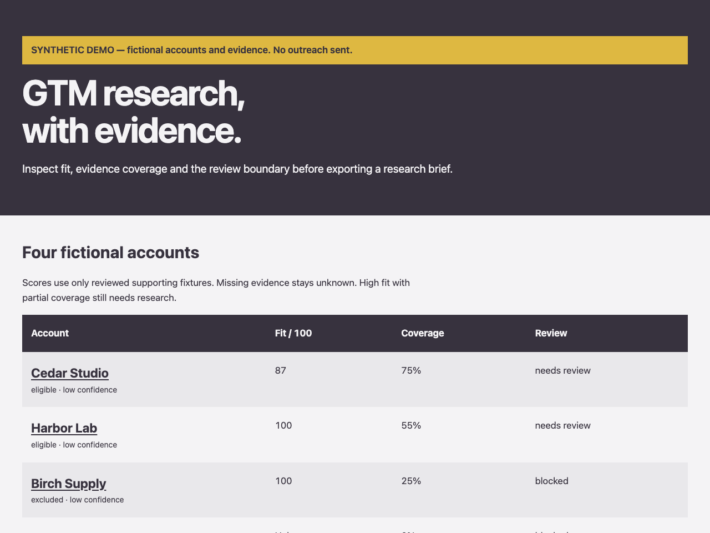
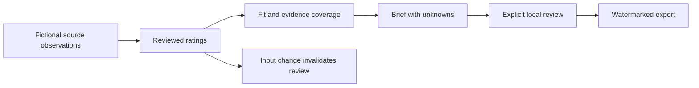

# GTM intelligence demo

[](https://github.com/tryclarityworks/gtm-intelligence-demo/actions/workflows/check.yml)

A local, credential-free example of source-linked account research, explainable scoring and explicit review. Prepared by Vatsal Jain with AI-assisted development, adapting a scoring module from a private local GTM prototype.

**Every account and observation is fictional. No outreach is sent.** Fit, evidence coverage and buying intent are separate questions.



## Run it

Node.js 22 or 24; no package installation or API keys:

```sh
node demo.mjs
node --test
```

Open `output/report.html` in a browser. Inspect `output/results.json` and edit supported inputs in `output/state.json`. An untouched [example report](examples/report.html) is also included.

## Try review invalidation

```sh
# Read the fictional Cedar brief in the report, then explicitly review it.
node demo.mjs review --id cedar --reviewer DemoReviewer
node demo.mjs export --id cedar

# Change a supported rating. The earlier review becomes stale.
node demo.mjs rate --id cedar --dimension segment --value 0.5
node demo.mjs export --id cedar
# Expected: nonzero exit, "Export blocked: a current explicit review is required"
```

The successful export is `output/approved-cedar.txt`, a synthetic research brief. Existing exports are dated snapshots, not an assertion of current approval. Regenerate and review after any input change. For a clean run use `node demo.mjs --output output/another-run`.

## What to inspect



- **Cedar:** fit 87/100 with 75% evidence coverage.
- **Harbor:** fit 100/100 with only 55% coverage. The higher score does not erase missing evidence.
- **Birch:** an explicit exclusion blocks approval even where a dimension matches.
- **Meadow:** missing support stays unknown; it is not scored as a negative observation.

The snapshot evaluates freshness at November 17, 2026 for reproducible fixtures. `demo://` sources are internal fictional references, not websites or independently verified intelligence. Synthetic evidence never produces a high real-source confidence rating.

## Implementation and limits

- [Scoring](lib/scoring.mjs): adapted implementation for reviewed evidence, weighting, freshness, eligibility and confidence.
- [Workflow](lib/workflow.mjs): synthetic validation, cited briefs, review hash and export gate.
- [CLI](demo.mjs): local state and report generation.
- [Tests](test/workflow.test.mjs): unknowns, evidence rejection, stale review, suppression, isolation, input validation and HTML escaping.

This is a small inspectable adaptation, not the full Next.js/SQLite application. See [provenance](PROVENANCE.md) for what was reused and what is new. The review hash detects changed inputs; it is not authentication. Anyone controlling the local state can alter its contents. There is no hosted service, concurrent state store, live research, CRM sync, model call, email transport or automated sending.

Fixture tests establish these boundaries, not real model accuracy, demand, conversions or revenue. No open-source reuse license has been assigned.

[Portfolio case study](https://www.vatsaljain.com/work/gtm-intelligence/) · [GitHub profile](https://github.com/tryclarityworks)
